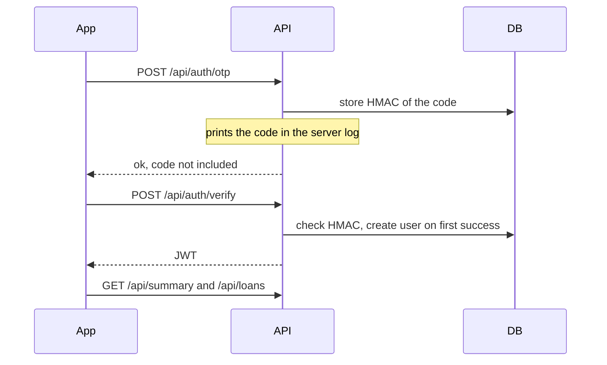

# MiniLedger

A small ledger for money you lent to friends. You sign in with your mobile number, add an entry (who, how much, when it is due), and mark it repaid. Overdue amounts stay visible.

The backend is Node.js, TypeScript, and PostgreSQL. The app is React Native (Expo) and also runs in a browser.

## Architecture

```
app/        Expo app. Login, summary, list, add form, optional receipt photo.
backend/    HTTP API. Mock OTP, JWT, loans, summary, receipt files on disk.
```

Phone login does not send an SMS. `POST /api/auth/otp` generates a 6-digit code, stores only an HMAC of it, and **prints the code in the API process log**. `POST /api/auth/verify` checks the code and returns a JWT that lasts 7 days. Later requests send `Authorization: Bearer <token>`.

Money is stored as `numeric(12,2)` rupees and returned as strings like `"1500.50"`, so nothing is rounded through a float. A loan is overdue when it is still open and its due date is **before today in Asia/Kolkata**. That rule lives in the SQL, not in a stored flag, and it does not depend on the database server's timezone.

Receipt photos are optional. The file is saved under `backend/uploads/` with a generated name. The database stores that name. Only the owner can download it.



## Prerequisites

- Node.js 22
- Docker (for Postgres), or any Postgres 16 you can point `DATABASE_URL` at

## Backend

From the repository root:

```bash
docker compose up -d
cd backend
cp .env.example .env
npm install
npm run migrate
npm run seed
npm run dev
```

`npm run dev` listens on [http://localhost:4000](http://localhost:4000).

| Script | What it does |
| --- | --- |
| `npm run dev` | API with reload. **OTP codes show up in this terminal.** |
| `npm run migrate` | Create the database if needed, then apply `migrations/*.sql` in order. |
| `npm run seed` | Sample entries for mobile number `9876543210`, if that phone has none yet. |
| `npm test` | Vitest + Supertest against the `miniledger_test` database. Creates that database if it is missing. |
| `npm run typecheck` | TypeScript without emitting files. |
| `npm run build` && `npm start` | Compile to `dist/` and run it. Migrate before starting. |

### Environment

Copy `backend/.env.example` to `backend/.env`.

| Variable | Purpose |
| --- | --- |
| `PORT` | API port. Default `4000`. |
| `DATABASE_URL` | Postgres connection string. |
| `JWT_SECRET` | Signs login tokens and keys the OTP HMAC. Change it outside local development. |
| `OTP_TTL_SECONDS` | How long a code stays valid. Default `300`. |
| `UPLOADS_DIR` | Where receipt files are written. Default `uploads`. |

### Where the mock OTP appears

It is **not** in the HTTP response and it is **not** in the Expo terminal.

It is printed by the API process (`npm run dev`) in this form:

```text
[miniledger] OTP for +919876543210 is 482913 (expires in 300 seconds)
```

The tests read that same line from the log.

`npm run seed` does not print a code. Sign in with `9876543210` and read the code from the API log.

## App

```bash
cd app
cp .env.example .env
npm install
npx expo start
```

- Press `w` to open the web build (React Native Web). Or run `npm run web`.
- Press `a` for the Android emulator, or scan the QR code with Expo Go on a phone.

`EXPO_PUBLIC_API_URL` is read when the bundle is built. Restart Expo after changing it.

| Where the app runs | `EXPO_PUBLIC_API_URL` |
| --- | --- |
| Expo web, iOS simulator | `http://localhost:4000` |
| Android emulator | `http://10.0.2.2:4000` |
| Physical phone (same Wi-Fi as the computer) | `http://<your computer LAN IP>:4000` |

Android cleartext HTTP is enabled in `app.json` so a local `http://` API works. Use HTTPS for anything beyond a local demo.

Check types with `npm run typecheck` inside `app/`.

## API

Errors are JSON: `{ "error": "what went wrong" }`.

Amounts are strings with two decimal places. Dates are `YYYY-MM-DD`.

### `GET /health`

`{ "ok": true }`

### `POST /api/auth/otp`

```json
{ "phone": "9876543210" }
```

Also accepts `09876543210`, `919876543210`, and `+91 98765 43210`. The stored form is `+919876543210`.

```json
{ "ok": true, "expiresInSeconds": 300 }
```

The code is written to the server log. Three requests for the same number are allowed per 10 minutes.

### `POST /api/auth/verify`

```json
{ "phone": "9876543210", "code": "482913" }
```

```json
{
  "token": "<jwt>",
  "user": { "id": "<uuid>", "phone": "+919876543210" }
}
```

The first successful verify creates the user. Five wrong guesses lock that code. Requesting a new code invalidates the previous one.

### `GET /api/summary`

Requires the bearer token.

```json
{ "totalLent": "4500.00", "totalRepaid": "1200.00", "overdueAmount": "800.00" }
```

`totalLent` is every entry. `totalRepaid` is entries with a repaid time. `overdueAmount` is still-open entries whose due date is before today in Asia/Kolkata. Due today is not overdue yet.

### `GET /api/loans`

```json
{
  "loans": [
    {
      "id": "<uuid>",
      "friendName": "Arjun Mehta",
      "amount": "800.00",
      "dueDate": "2026-10-20",
      "repaidAt": null,
      "overdue": true,
      "hasReceipt": false,
      "createdAt": "2026-10-21T12:00:00.000Z"
    }
  ]
}
```

Open entries come first, soonest due date first. Another user's entries are not included.

### `POST /api/loans`

JSON:

```json
{ "friendName": "Asha Sharma", "amount": "1500.50", "dueDate": "2026-11-01" }
```

Or `multipart/form-data` with the same fields plus an optional `receipt` file (JPEG, PNG, or WebP, up to 5 MB).

`201` and `{ "loan": { ... } }`.

### `POST /api/loans/:id/repay`

Sets `repaid_at` if it was empty. Calling it again returns the same timestamp. Someone else's id is a 404.

### `GET /api/loans/:id/receipt`

The image bytes, only for the owner. `404` when the entry has no photo.

## Tests

`backend` tests need Postgres running (`docker compose up -d` is enough). They use `backend/.env.test`, create `miniledger_test` if it does not exist, migrate, and truncate their tables between cases. They refuse to run if `DATABASE_URL` is not the test database.

GitHub Actions runs those tests and `npm run typecheck` in `app/`.

## Layout

```
backend/src/index.ts          starts the server
backend/src/app.ts            Express app, also used by tests
backend/src/auth.ts           OTP, HMAC, JWT
backend/src/loans.ts          SQL for entries and the summary
backend/src/routes/           HTTP only
backend/src/validation.ts     zod
backend/migrations/001_init.sql
app/App.tsx                   session gate
app/src/screens/              login and ledger
app/src/api.ts                fetch wrapper
```
